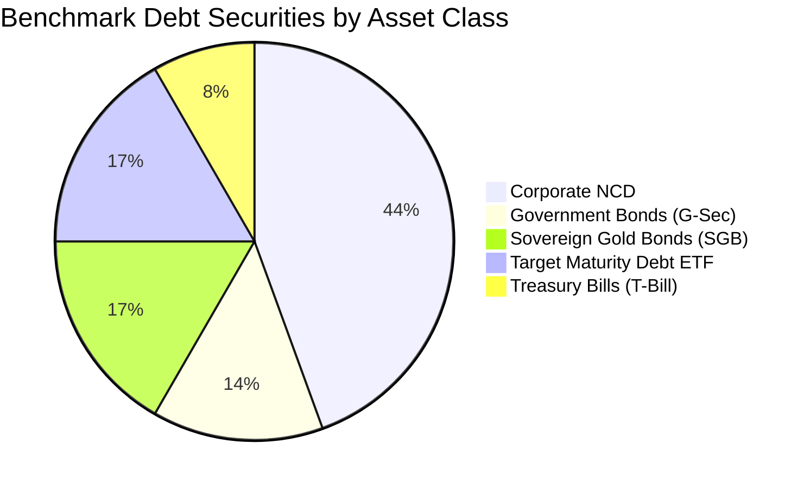

# Debtinst_s 🏛️📈

> **High Return with Manageable Risk across Corporate Bonds, Gold Bonds, and Government Securities.**

[](https://github.com/suraajde/Debtinst_s/actions/workflows/ci.yml)
[](https://www.python.org/)
[](#zero-dependency-execution)
[](https://github.com/suraajde/Debtinst_s/releases)
[](LICENSE)

---

## 🎯 Project Vision

Fixed-income investors in Indian capital markets face a fundamental dilemma:
* **Government Securities (`G-Sec`) & Treasury Bills (`T-Bill`)** offer absolute sovereign safety (`SOV`), but modest nominal yields.
* **Sovereign Gold Bonds (`SGB`)** deliver an attractive 2.50% annual coupon plus physical gold price parity and 100% tax-free capital gains at maturity.
* **Corporate Non-Convertible Debentures (`NCD`)** offer high coupons (7.5% - 10.5%+), but carry credit risk. Unsecured or subordinated debt has historically exposed investors to catastrophic loss during corporate insolvencies.
* **Target Maturity Debt ETFs (`Bharat Bond`, `SDL ETFs`)** provide AAA PSU quality with defined maturity roll-down curves and minimal expense ratios (0.005%).

`Debtinst_s` is designed to systematically solve this problem. It equips analysts and individual investors with tools to **filter out speculative and unsecured credit risk**, isolating high-return, manageable-risk fixed-income securities backed by **1.25x to 1.50x asset coverage**, premier ratings (`CRISIL/ICRA AAA`, `AA+`), and sovereign guarantees.

---

## ⚡ Core Architectural Constraint: Zero Dependencies

`Debtinst_s` is engineered under a strict zero-dependency architectural mandate:

* **Universal Portability**: Runs on **any** computer with standard Python 3 (Python 3.8+) without running `pip install` or downloading third-party packages.
* **Pure Standard Library Math**: Bond pricing, Newton-Raphson solvers, yield curve interpolation, duration, convexity, and portfolio ladders are implemented entirely using Python's `math`, `statistics`, and `datetime` (no `numpy`, `scipy`, or `pandas`).
* **Self-Contained Seed Data**: All baseline benchmark datasets (36+ institutional securities across 4 asset classes) are embedded directly in [`src/embedded_seed.py`](file:///d:/Debtinst_s/src/embedded_seed.py).
* **Live Free-API Ingestion Engine**: Built purely using Python's standard `urllib.request` and `http.cookiejar`, connecting directly to free public market feeds (NSE India and Yahoo Finance) without paid API keys.
* **Auto-Materializing SQLite Engine**: At runtime, the database engine automatically materializes the embedded dataset into a high-performance local SQLite database ([`data/debt_securities.db`](file:///d:/Debtinst_s/data/debt_securities.db)) using only Python's built-in `sqlite3` standard library.
* **Zero Network Reliance**: Functions 100% offline in air-gapped, institutional, or CI runner environments through deterministic fallbacks.

---

## 🗺️ 5-Sprint Roadmap

| Sprint | Phase & Focus | Deliverables & Milestones | Status |
| :---: | :--- | :--- | :---: |
| **Sprint 1** | **Architecture & Embedded Offline Database** | <ul><li>Zero-dependency project layout (`src/`, `data/`, `tests/`, `dist_portable/`)</li><li>Comprehensive embedded seed dataset of 36+ benchmark bonds</li><li>SQLite auto-materialization schema with performance indexes</li><li>Standard library unit test suite (`tests/test_embedded_seed.py`)</li><li>Automated multi-OS CI workflow</li></ul> | **Completed** ✅<br>`v0.1.0-init` |
| **Sprint 2** | **Free-API Live Data & Bhavcopy Ingestion Engine** | <ul><li>Browser-grade NSE cookie session manager (`_create_nse_opener`)</li><li>Live NSE endpoints for SGBs, G-Secs, and Corporate NCDs</li><li>Live 24K Gold benchmark derivation via Yahoo Finance (GOLDBEES)</li><li>Flexible CSV Bhavcopy offline import engine (`import_bhavcopy_csv`)</li><li>Non-destructive schema migration (`current_price`, `traded_volume`, `market_sync_log`)</li><li>Comprehensive mock test suite (`tests/test_data_engine.py`)</li></ul> | **Completed** ✅<br>`v0.2.0-data` |
| **Sprint 3** | **Quantitative Pricing, Sovereign Curve & Risk Engine** | <ul><li>Exact Newton-Raphson & Bisection YTM solver across coupon frequencies</li><li>SGB Gold-parity valuation, discount-to-spot, & expected gold CAGR</li><li>Dynamic piecewise-linear Sovereign Yield Curve & Credit Spread (bps)</li><li>Macaulay Duration, Modified Duration, Convexity, & +100 bps rate shock</li><li>Yield-Trap Guardrail ($R_w, S_w, A_m$) & RAYS scoring model</li><li>Multi-criteria high-return manageable-risk screener</li><li>12-Month Calendar Cash-Flow & Coupon Ladder Simulator</li><li>Quantitative test suite with 16 tests (`tests/test_quant_engine.py`)</li></ul> | **Completed** ✅<br>`v0.3.0-quant` |
| **Sprint 4** | **Portfolio Allocation & Manageable-Risk Optimizer** | <ul><li>Multi-asset barbell strategy (G-Sec/SGB + Senior Secured NCDs)</li><li>Duration matching and liquidity laddering</li><li>Rebalancing recommendations and concentration limit guards</li><li>Scenario analysis (interest rate shocks: $+100\text{ bps}$, $-100\text{ bps}$)</li></ul> | *Next* ⏳ |
| **Sprint 5** | **Interactive Terminal UI & Portable Distribution** | <ul><li>Curses / ANSI interactive terminal dashboard (zero 3P dependencies)</li><li>Export engines (CSV, JSON, Markdown portfolio reports)</li><li>Portable self-contained bundle in `dist_portable/`</li><li>One-click launcher for Windows, Linux, and macOS</li></ul> | *Planned* 📅 |

---

## 🧮 Quantitative Model & Risk Guardrail

### 1. Exact Yield-to-Maturity (YTM) Solver
For coupon-bearing bonds, the price $P$ is modeled as the discounted sum of periodic cash flows:
$$P(y) = \sum_{k=1}^n \frac{C}{(1+y)^k} + \frac{F}{(1+y)^n}$$
where $C = \frac{F \times (\text{coupon} / 100)}{m}$, $m$ is the payment frequency per year, and $n = \text{round}(T \times m)$.
The engine solves for periodic yield $y$ using **Newton-Raphson iterations**:
$$y_{i+1} = y_i - \frac{P(y_i) - P_{\text{market}}}{P'(y_i)}$$
with an automatic **Bisection fallback** over $[-20\%, +100\%]$ to guarantee convergence even for deeply discounted or volatile instruments.

* **Treasury Bills (`T-Bill`):** Zero-coupon discount yield:
  $$\text{YTM}_{\text{T-Bill}} = \left(\frac{F}{P} - 1\right) \times \frac{1}{T} \times 100$$
* **Sovereign Gold Bonds (`SGB`):** Combines the fixed 2.50% coupon on issue price, the annualized pull-to-gold-parity from current market price to spot gold, and the expected gold CAGR (default 7.50%):
  $$\text{YTM}_{\text{SGB}} = \frac{2.50 \times F}{P} + \left(\frac{\text{Spot}_{\text{Gold}} - P}{P \times T}\right) \times 100 + \text{CAGR}_{\text{Gold}}$$
* **Target Maturity Debt ETFs (`Debt ETF`):** Computed net of annual expense ratio:
  $$\text{YTM}_{\text{Net}} = \max(0.0, \text{YTM}_{\text{Gross}} - \text{Expense Ratio} \times 100)$$

### 2. Sovereign Yield Curve & Credit Spread
The engine dynamically builds a piecewise-linear **Sovereign Benchmark Curve** from active G-Secs and T-Bills sorted by maturity $T$. For any corporate security, it interpolates the matched sovereign yield $Y_{\text{G-Sec}}(T)$ and computes the credit spread in basis points:
$$\text{Spread}_{\text{G-Sec}} = (Y_{\text{Bond}} - Y_{\text{G-Sec}}(T)) \times 100 \quad [\text{bps}]$$

### 3. Downside Protection & Yield-Trap Guardrail
To prevent algorithms from chasing deceptive yields on distressed debt, the engine evaluates three safety weights:
* **Rating Weight ($R_w$):** $\text{SOV}=1.00$, $\text{AAA}=0.96$, $\text{AA+}=0.88$, $\text{AA}=0.80$, $\text{AA-}=0.68$, $\text{A+}=0.55$, $\text{A}=0.45$, $\text{BBB}=0.30$, $\text{D}=0.00$.
* **Seniority Weight ($S_w$):** $\text{Sovereign}=1.00$, $\text{Senior Secured}=0.92$, $\text{Secured}=0.75$, $\text{Unsecured Subordinated / Tier-II}=0.38$.
* **Asset Cover Multiplier ($A_m$):** Rewards asset cover $\ge 1.25\times$ (up to $1.10\times$ at $1.50\times$), while penalizing cover $< 1.00\times$ ($0.40$).

A security is flagged as **`is_yield_trap = True`** if:
1. It carries a `D` / `DEFAULT` rating, OR
2. It trades below $65\%$ of face value on a coupon-bearing corporate bond, OR
3. Its credit spread exceeds $+650\text{ bps}$ alongside subordinated seniority or sub-AA rating.

### 4. Risk-Adjusted Yield Score (RAYS)
If flagged as a yield trap, $\text{RAYS} = 0.0$. Otherwise:
$$\text{RAYS} = \frac{\text{Effective YTM} \times R_w \times S_w \times A_m}{\sqrt{\max(D_{\text{mod}}, 0.50)}}$$
This penalizes long-duration volatility and unbacked credit risk, while boosting high-cover, senior secured AAA/AA+ bonds.

---

## 📊 Benchmark Asset Categories in Database

The embedded dataset in [`src/embedded_seed.py`](file:///d:/Debtinst_s/src/embedded_seed.py) covers 36 representative instruments:



| Asset Category | Benchmark Instruments | Rating & Seniority | Key Features |
| :--- | :--- | :--- | :--- |
| **G-Sec** | 7.18% GS 2033, 7.10% GS 2034, 7.06% GS 2028, 7.26% GS 2032, 6.64% GS 2035 | `SOV` / Sovereign | 100% Sovereign Guarantee, zero default risk, high liquidity via CCIL |
| **T-Bill** | 91-Day, 182-Day, 364-Day Treasury Bills | `SOV` / Sovereign | Zero-coupon discount instruments, cash-management & ultra-short duration |
| **SGB** | SGB 2023-24 Series IV, III, II, I; 2022-23 Series IV; 2020-21 Series VI | `SOV` / Sovereign | 2.50% p.a. semi-annual coupon + 1.0g gold parity, 100% tax-free capital gains at maturity |
| **Corporate NCD (Tier A)** | HDFC Ltd, Bajaj Finance, REC Ltd, PFC Ltd, IRFC, Kotak Prime | `CRISIL/ICRA AAA`, Senior Secured | **$1.35\times$ to $1.50\times$ Asset Cover**, high returns, manageable institutional risk |
| **Corporate NCD (Tier B)** | L&T Finance, Shriram Finance, Manappuram Finance, Tata Motors Finance | `CRISIL/CARE AA+ / AA`, Senior Secured / Secured | **$1.25\times$ to $1.30\times$ Asset Cover**, 8.15% - 9.10% yield with strong collateral |
| **Corporate NCD (Tier C)** | SBI Tier-II, Yes Bank Tier-II, Spandana Sphoorty, Reliance Capital (Defaulted) | `AAA` to `CARE D`, Unsecured Subordinated | Used by the engine for negative filtering, stress testing, and risk warnings |
| **Debt ETF** | Bharat Bond ETFs (2025, 2030, 2031, 2032), Nippon SDL 2026, SBI CPSE SDL | `AAA` / `SOV`, Target Maturity | Target maturity roll-down, 0.005% expense ratio, indexation tracking |

---

## 🚀 Zero-Dependency Execution Instructions

### Prerequisites
* Any operating system: **Windows**, **macOS**, or **Linux**.
* Standard **Python 3.8+** (no pip packages or virtual environments needed).

### 1. Auto-Materialize the Offline SQLite Database
```bash
python src/embedded_seed.py
```

### 2. Run the Full Test Suite (41 Tests across 3 Test Suites)
Validate database creation, live ingestion mocks, gold price derivation, Bhavcopy CSV imports, YTM calculations, duration/convexity, yield-trap guardrails, and cash-flow ladders:

```bash
python -m unittest discover tests -v
```

*Output:*
```text
Ran 41 tests in 5.176s
OK
```

### 3. Quantitative Engine Usage (`src/quant_engine.py`)

#### Screen High-Return, Manageable-Risk Debt Securities
```python
from src.quant_engine import BondQuantEngine

quant = BondQuantEngine()

# Screen bonds with rating >= AA, asset cover >= 1.25x, excluding yield traps
screened_bonds = quant.screen_securities(
    min_rating="AA",
    min_asset_cover=1.25,
    exclude_yield_traps=True,
)

print(f"Discovered {len(screened_bonds)} qualifying high-quality bonds:")
for b in screened_bonds[:5]:
    print(
        f"{b['symbol']:12} | {b['category']:14} | Rating: {b['rating']:10} "
        f"| YTM: {b['effective_ytm']:.2f}% | D_mod: {b['modified_duration']:.2f}y "
        f"| Spread: {b['spread_over_gsec_bps']:+4.0f} bps | RAYS: {b['rays_score']:.2f}"
    )
```

#### Simulate a 12-Month Portfolio Cash-Flow Ladder
```python
from src.quant_engine import BondQuantEngine

quant = BondQuantEngine()
screened = quant.screen_securities(min_rating="AAA", min_asset_cover=1.25)

# Allocate INR 5,00,000 using RAYS-weighting across top bonds
ladder_report = quant.generate_cashflow_ladder(
    securities=screened[:5],
    total_capital_inr=500000.0,
    allocation_mode="rays_weighted",
)

print(f"Portfolio Weighted YTM:      {ladder_report['weighted_effective_ytm']}%")
print(f"Portfolio Duration:          {ladder_report['weighted_modified_duration']} years")
print(f"Sovereign & Senior Secured:  {ladder_report['sovereign_and_senior_secured_pct']}%")
print(f"Annual Coupon Cash Inflow:   INR {ladder_report['total_annual_coupon_inflow']:,.2f}")

# Inspect monthly coupon payouts
for month, flow in ladder_report["monthly_schedule"].items():
    if flow["coupon"] > 0:
        print(f"  * {month}: Coupon INR {flow['coupon']:,.2f}")
```

---

## 📁 Repository Structure

```text
Debtinst_s/
├── .github/
│   └── workflows/
│       └── ci.yml             # Multi-OS CI testing Python 3.10 - 3.13 without pip dependencies
├── data/
│   ├── .gitkeep              # Directory tracked; SQLite DB materialized at runtime
│   └── debt_securities.db    # Auto-materialized local SQLite database
├── dist_portable/
│   └── .gitkeep              # Destination for zero-install portable deployment bundles
├── src/
│   ├── __init__.py           # Package initialization & version metadata (v0.3.0)
│   ├── embedded_seed.py      # Embedded 36-security dataset & SQLite auto-materializer
│   ├── data_engine.py        # Free-API Live Ingestion, Bhavcopy CSV, & Gold Derivation
│   └── quant_engine.py       # Newton-Raphson YTM, Sovereign Curve, RAYS & Ladder Engine
├── tests/
│   ├── __init__.py           # Test package initialization
│   ├── test_embedded_seed.py # Seed integrity & SQLite materialization tests (12 tests)
│   ├── test_data_engine.py   # Live ingestion, mock endpoints, CSV import & fallback tests (13 tests)
│   └── test_quant_engine.py  # Pricing, YTM, SGB parity, RAYS & ladder tests (16 tests)
├── .gitignore                # Excludes caches, builds, environments, and local DBs
├── LICENSE                   # MIT License
└── README.md                 # Project vision, roadmap, and quantitative model guide
```

---

## 🛡️ License

This project is licensed under the [MIT License](LICENSE).
