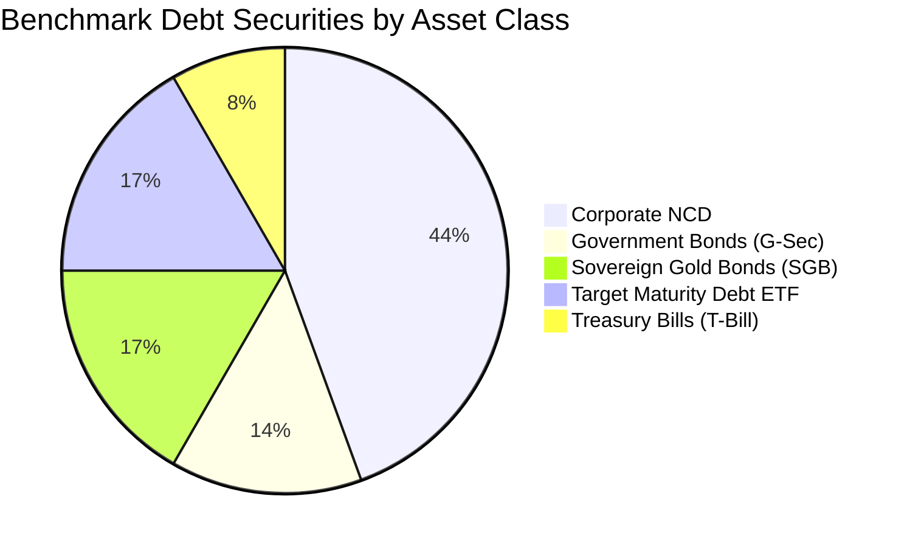

# Debtinst_s 🏛️📈

> **High Return with Manageable Risk across Corporate Bonds, Gold Bonds, and Government Securities.**

[](https://github.com/suraajde/Debtinst_s/actions/workflows/ci.yml)
[](https://www.python.org/)
[](#zero-dependency-execution)
[](https://github.com/suraajde/Debtinst_s/releases)
[](LICENSE)

---

## 🎯 Project Vision

Fixed-income investors in Indian capital markets face a fundamental dilemma:
* **Government Securities (`G-Sec`) & Treasury Bills (`T-Bill`)** offer absolute sovereign safety (`SOV`), but modest yields.
* **Sovereign Gold Bonds (`SGB`)** deliver an attractive 2.50% annual coupon plus physical gold price parity and 100% tax-free capital gains at maturity.
* **Corporate Non-Convertible Debentures (`NCD`)** offer high coupons (7.5% - 10.5%+), but carry credit risk. Unsecured or subordinated debt has historically exposed investors to catastrophic loss during corporate insolvencies.
* **Target Maturity Debt ETFs (`Bharat Bond`, `SDL ETFs`)** provide AAA PSU quality with defined maturity roll-down curves and minimal expense ratios (0.005%).

`Debtinst_s` is designed to systematically solve this problem. It equips analysts and individual investors with tools to **filter out speculative and unsecured credit risk**, isolating high-return, manageable-risk fixed-income securities backed by **1.25x to 1.50x asset coverage**, premier ratings (`CRISIL/ICRA AAA`, `AA+`), and sovereign guarantees.

---

## ⚡ Core Architectural Constraint: Zero Dependencies

`Debtinst_s` is engineered under a strict zero-dependency architectural mandate:

* **Universal Portability**: Runs on **any** computer with standard Python 3 (Python 3.8+) without running `pip install` or downloading third-party packages.
* **Self-Contained Seed Data**: All baseline benchmark datasets (36+ institutional securities across 4 asset classes) are embedded directly in [`src/embedded_seed.py`](file:///d:/Debtinst_s/src/embedded_seed.py).
* **Live Free-API Ingestion Engine**: Built purely using Python's standard `urllib.request` and `http.cookiejar`, connecting directly to free public market feeds (NSE India and Yahoo Finance) without paid API keys.
* **Auto-Materializing SQLite Engine**: At runtime, the database engine automatically materializes the embedded dataset into a high-performance local SQLite database ([`data/debt_securities.db`](file:///d:/Debtinst_s/data/debt_securities.db)) using only Python's built-in `sqlite3` standard library.
* **Zero Network Reliance**: Functions 100% offline in air-gapped, institutional, or CI runner environments through deterministic fallbacks.

---

## 🗺️ 5-Sprint Roadmap

| Sprint | Phase & Focus | Deliverables & Milestones | Status |
| :---: | :--- | :--- | :---: |
| **Sprint 1** | **Architecture & Embedded Offline Database** | <ul><li>Zero-dependency project layout (`src/`, `data/`, `tests/`, `dist_portable/`)</li><li>Comprehensive embedded seed dataset of 36+ benchmark bonds</li><li>SQLite auto-materialization schema with performance indexes</li><li>Standard library unit test suite (`tests/test_embedded_seed.py`)</li><li>Automated multi-OS CI workflow</li></ul> | **Completed** ✅<br>`v0.1.0-init` |
| **Sprint 2** | **Free-API Live Data & Bhavcopy Ingestion Engine** | <ul><li>Browser-grade NSE cookie session manager (`_create_nse_opener`)</li><li>Live NSE endpoints for SGBs, G-Secs, and Corporate NCDs</li><li>Live 24K Gold benchmark derivation via Yahoo Finance (GOLDBEES)</li><li>Flexible CSV Bhavcopy offline import engine (`import_bhavcopy_csv`)</li><li>Non-destructive schema migration (`current_price`, `traded_volume`, `market_sync_log`)</li><li>Comprehensive mock test suite (`tests/test_data_engine.py`)</li></ul> | **Completed** ✅<br>`v0.2.0-data` |
| **Sprint 3** | **Risk Scoring, YTM & Asset Cover Engine** | <ul><li>Deterministic risk scoring model (0-100 score & letter tiers)</li><li>Asset Cover Ratio filter (isolating $\ge 1.25\times$ to $1.50\times$)</li><li>Subordinated & unsecured debt exclusion rules</li><li>Closed-form & iterative YTM, duration, and convexity calculations</li></ul> | *Next* ⏳ |
| **Sprint 4** | **Portfolio Allocation & Manageable-Risk Optimizer** | <ul><li>Multi-asset barbell strategy (G-Sec/SGB + Senior Secured NCDs)</li><li>Duration matching and liquidity laddering</li><li>Rebalancing recommendations and concentration limit guards</li><li>Scenario analysis (interest rate shocks: $+100\text{ bps}$, $-100\text{ bps}$)</li></ul> | *Planned* 📅 |
| **Sprint 5** | **Interactive Terminal UI & Portable Distribution** | <ul><li>Curses / ANSI interactive terminal dashboard (zero 3P dependencies)</li><li>Export engines (CSV, JSON, Markdown portfolio reports)</li><li>Portable self-contained bundle in `dist_portable/`</li><li>One-click launcher for Windows, Linux, and macOS</li></ul> | *Planned* 📅 |

---

## 📊 Benchmark Asset Categories in Database

The embedded dataset in [`src/embedded_seed.py`](file:///d:/Debtinst_s/src/embedded_seed.py) covers 36 representative instruments:



| Asset Category | Benchmark Instruments | Rating & Seniority | Key Features |
| :--- | :--- | :--- | :--- |
| **G-Sec** | 7.18% GS 2033, 7.10% GS 2034, 7.06% GS 2028, 7.26% GS 2032, 6.64% GS 2035 | `SOV` / Sovereign | 100% Sovereign Guarantee, zero default risk, high liquidity via CCIL |
| **T-Bill** | 91-Day, 182-Day, 364-Day Treasury Bills | `SOV` / Sovereign | Zero-coupon discount instruments, cash-management & ultra-short duration |
| **SGB** | SGB 2023-24 Series IV, III, II, I; 2022-23 Series IV; 2020-21 Series VI | `SOV` / Sovereign | 2.50% p.a. semi-annual coupon + 1.0g gold parity, 100% tax-free capital gains at maturity |
| **Corporate NCD (Tier A)** | HDFC Ltd, Bajaj Finance, REC Ltd, PFC Ltd, IRFC, Kotak Prime | `CRISIL/ICRA AAA`, Senior Secured | **$1.35\times$ to $1.50\times$ Asset Cover**, high returns, manageable institutional risk |
| **Corporate NCD (Tier B)** | L&T Finance, Shriram Finance, Manappuram Finance, Tata Motors Finance | `CRISIL/CARE AA+ / AA`, Senior Secured / Secured | **$1.25\times$ to $1.30\times$ Asset Cover**, 8.15% - 9.10% yield with strong collateral |
| **Corporate NCD (Tier C)** | SBI Tier-II, Yes Bank Tier-II, Spandana Sphoorty, Reliance Capital (Defaulted) | `AAA` to `CARE D`, Unsecured Subordinated | Used by the engine for negative filtering, stress testing, and risk warnings |
| **Debt ETF** | Bharat Bond ETFs (2025, 2030, 2031, 2032), Nippon SDL 2026, SBI CPSE SDL | `AAA` / `SOV`, Target Maturity | Target maturity roll-down, 0.005% expense ratio, indexation tracking |

---

## 🚀 Zero-Dependency Execution Instructions

### Prerequisites
* Any operating system: **Windows**, **macOS**, or **Linux**.
* Standard **Python 3.8+** (no pip packages or virtual environments needed).

### 1. Auto-Materialize the Offline SQLite Database
Run the embedded seed module directly to initialize [`data/debt_securities.db`](file:///d:/Debtinst_s/data/debt_securities.db):

```bash
python src/embedded_seed.py
```

### 2. Run the Full Unit Test Suite (25 Tests)
Validate database creation, live ingestion mocks, gold price derivation, Bhavcopy CSV imports, and offline fallback using Python's standard `unittest`:

```bash
python -m unittest discover tests -v
```

*Output:*
```text
Ran 25 tests in 1.164s
OK
```

### 3. Using the Market Data Engine (`src/data_engine.py`)

#### Fetch Unified Market Snapshot (Live or Offline Fallback)
```python
from src.data_engine import DebtMarketDataEngine

# Initialize the engine (automatically ensures database & tables are ready)
engine = DebtMarketDataEngine()

# Get snapshot (allow_network=True queries free APIs, falls back cleanly if offline)
snapshot = engine.get_market_snapshot(allow_network=True)

print(f"Data Source Mode: {snapshot['data_source']}")  # 'LIVE_FREE_API' or 'OFFLINE_EMBEDDED_DB'
print(f"24K Gold Benchmark: INR {snapshot['gold_24k_inr']:,.2f} / gram")
print(f"Total Securities Tracked: {len(snapshot['securities'])}")
```

#### Offline CSV / Bhavcopy Ingestion
Import or update daily traded bond sheets directly from CSV strings, files, or streams:
```python
from src.data_engine import DebtMarketDataEngine

engine = DebtMarketDataEngine()

# Flexible column header matching (ISIN, SYMBOL, CLOSE/LTP, VOLUME, COUPON, RATING, ASSET_COVER)
daily_bhavcopy = """ISIN,SYMBOL,CLOSE,TOTTRDQTY,RATING,ASSET_COVER
INE001A07TO2,HDFC27,1018.50,15400,CRISIL AAA,1.50
INE296A07RX6,BAJFIN28,1022.00,8200,CRISIL AAA,1.40
INE721A07QU8,SHRIRAM28,1035.00,6100,CRISIL AA+,1.25
"""

records_updated = engine.import_bhavcopy_csv(daily_bhavcopy)
print(f"Successfully updated {records_updated} bonds from Bhavcopy.")
```

#### Query High-Return, Manageable-Risk Corporate Bonds
```python
from src.embedded_seed import query_securities

# Filter Senior Secured bonds with asset cover >= 1.25x
high_cover_bonds = query_securities(category="Corporate NCD", min_asset_cover=1.25)
for b in high_cover_bonds:
    print(f"{b['symbol']:12} | Rating: {b['rating']:10} | Cover: {b['asset_cover_ratio']}x | Coupon: {b['coupon_rate']}% | Price: INR {b.get('current_price')}")
```

---

## 📁 Repository Structure

```text
Debtinst_s/
├── .github/
│   └── workflows/
│       └── ci.yml             # Multi-OS CI testing Python 3.10 - 3.13 without pip dependencies
├── data/
│   ├── .gitkeep              # Directory tracked; SQLite DB materialized at runtime
│   └── debt_securities.db    # Auto-materialized local SQLite database
├── dist_portable/
│   └── .gitkeep              # Destination for zero-install portable deployment bundles
├── src/
│   ├── __init__.py           # Package initialization & version metadata (v0.2.0)
│   ├── embedded_seed.py      # Embedded 36-security dataset & SQLite auto-materializer
│   └── data_engine.py        # Free-API Live Ingestion, Bhavcopy CSV, & Gold Derivation
├── tests/
│   ├── __init__.py           # Test package initialization
│   ├── test_embedded_seed.py # Seed integrity & SQLite materialization tests (12 tests)
│   └── test_data_engine.py   # Live ingestion, mock endpoints, CSV import & fallback tests (13 tests)
├── .gitignore                # Excludes caches, builds, environments, and local DBs
├── LICENSE                   # MIT License
└── README.md                 # Project vision, roadmap, and execution guide
```

---

## 🛡️ License

This project is licensed under the [MIT License](LICENSE).
