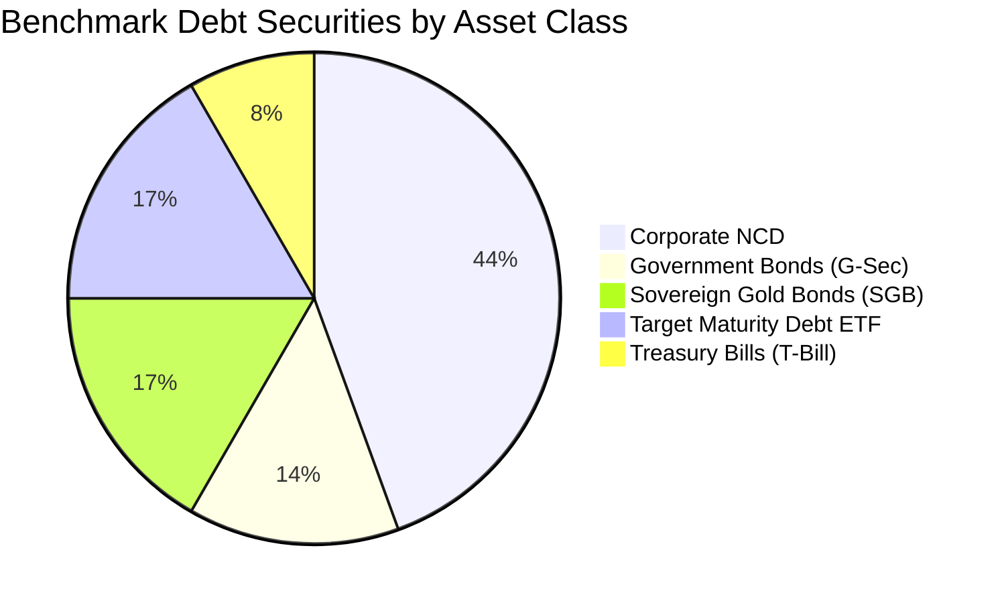

# Debtinst_s 🏛️📈

> **High Return with Manageable Risk across Corporate Bonds, Gold Bonds, and Government Securities.**

[](https://github.com/suraajde/Debtinst_s/actions/workflows/ci.yml)
[](https://www.python.org/)
[](#zero-dependency-execution)
[](LICENSE)

---

## 🎯 Project Vision

Fixed-income investors in Indian capital markets face a fundamental dilemma:
* **Government Securities (`G-Sec`) & Treasury Bills (`T-Bill`)** offer absolute sovereign safety (`SOV`), but modest yields.
* **Sovereign Gold Bonds (`SGB`)** deliver an attractive 2.50% annual coupon plus physical gold price parity and 100% tax-free capital gains at maturity.
* **Corporate Non-Convertible Debentures (`NCD`)** offer high coupons (7.5% - 10.5%+), but carry credit risk. Unsecured or subordinated debt has historically exposed investors to catastrophic loss during corporate insolvencies.
* **Target Maturity Debt ETFs (`Bharat Bond`, `SDL ETFs`)** provide AAA PSU quality with defined maturity roll-down curves and minimal expense ratios (0.005%).

`Debtinst_s` is designed to systematically solve this problem. It equips analysts and individual investors with tools to **filter out speculative and unsecured credit risk**, isolating high-return, manageable-risk fixed-income securities backed by **1.25x to 1.50x asset coverage**, premier ratings (`CRISIL/ICRA AAA`, `AA+`), and sovereign guarantees.

---

## ⚡ Core Architectural Constraint: Zero Dependencies

`Debtinst_s` is engineered under a strict zero-dependency architectural mandate:

* **Universal Portability**: Runs on **any** computer with standard Python 3 (Python 3.8+) without running `pip install` or downloading third-party packages.
* **Self-Contained Seed Data**: All baseline benchmark datasets (36+ institutional securities across 4 asset classes) are embedded directly in [`src/embedded_seed.py`](file:///d:/Debtinst_s/src/embedded_seed.py).
* **Auto-Materializing SQLite Engine**: At runtime, the database engine automatically materializes the embedded dataset into a high-performance local SQLite database ([`data/debt_securities.db`](file:///d:/Debtinst_s/data/debt_securities.db)) using only Python's built-in `sqlite3` standard library.
* **Zero Network Reliance**: Functions 100% offline in air-gapped, institutional, or restricted environments.

---

## 🗺️ 5-Sprint Roadmap

| Sprint | Phase & Focus | Deliverables & Milestones | Status |
| :---: | :--- | :--- | :---: |
| **Sprint 1** | **Architecture & Embedded Offline Database** | <ul><li>Zero-dependency project layout (`src/`, `data/`, `tests/`, `dist_portable/`)</li><li>Comprehensive embedded seed dataset of 36+ benchmark bonds</li><li>SQLite auto-materialization schema with performance indexes</li><li>Standard library unit test suite (`tests/test_embedded_seed.py`)</li><li>Automated multi-OS CI workflow</li></ul> | **Completed** ✅ |
| **Sprint 2** | **Risk Scoring & Asset Cover Isolation Engine** | <ul><li>Deterministic risk scoring model (0-100 score & letter tiers)</li><li>Asset Cover Ratio filter (isolating $\ge 1.25\times$ to $1.50\times$)</li><li>Subordinated & unsecured debt exclusion rules</li><li>Sovereign backstop and PSU categorization logic</li></ul> | *Next* ⏳ |
| **Sprint 3** | **Yield-to-Maturity (YTM) & Cash Flow Analytics** | <ul><li>Closed-form & iterative internal rate of return (YTM calculation)</li><li>Macaulay duration, Modified duration, and Convexity models</li><li>Cash flow schedules for semi-annual, annual, and monthly payouts</li><li>SGB gold price sensitivity and capital gains tax-adjusted yield</li></ul> | *Planned* 📅 |
| **Sprint 4** | **Portfolio Allocation & Manageable-Risk Optimizer** | <ul><li>Multi-asset barbell strategy (G-Sec/SGB + Senior Secured NCDs)</li><li>Duration matching and liquidity laddering</li><li>Rebalancing recommendations and concentration limit guards</li><li>Scenario analysis (interest rate shocks: $+100\text{ bps}$, $-100\text{ bps}$)</li></ul> | *Planned* 📅 |
| **Sprint 5** | **Interactive Terminal UI & Portable Distribution** | <ul><li>Curses / ANSI interactive terminal dashboard (zero 3P dependencies)</li><li>Export engines (CSV, JSON, Markdown portfolio reports)</li><li>Portable self-contained bundle in `dist_portable/`</li><li>One-click launcher for Windows, Linux, and macOS</li></ul> | *Planned* 📅 |

---

## 📊 Benchmark Asset Categories in Database

The embedded dataset in [`src/embedded_seed.py`](file:///d:/Debtinst_s/src/embedded_seed.py) covers 36 representative instruments:



| Asset Category | Benchmark Instruments | Rating & Seniority | Key Features |
| :--- | :--- | :--- | :--- |
| **G-Sec** | 7.18% GS 2033, 7.10% GS 2034, 7.06% GS 2028, 7.26% GS 2032, 6.64% GS 2035 | `SOV` / Sovereign | 100% Sovereign Guarantee, zero default risk, high liquidity via CCIL |
| **T-Bill** | 91-Day, 182-Day, 364-Day Treasury Bills | `SOV` / Sovereign | Zero-coupon discount instruments, cash-management & ultra-short duration |
| **SGB** | SGB 2023-24 Series IV, III, II, I; 2022-23 Series IV; 2020-21 Series VI | `SOV` / Sovereign | 2.50% p.a. semi-annual coupon + 1.0g gold parity, 100% tax-free capital gains at maturity |
| **Corporate NCD (Tier A)** | HDFC Ltd, Bajaj Finance, REC Ltd, PFC Ltd, IRFC, Kotak Prime | `CRISIL/ICRA AAA`, Senior Secured | **$1.35\times$ to $1.50\times$ Asset Cover**, high returns, manageable institutional risk |
| **Corporate NCD (Tier B)** | L&T Finance, Shriram Finance, Manappuram Finance, Tata Motors Finance | `CRISIL/CARE AA+ / AA`, Senior Secured / Secured | **$1.25\times$ to $1.30\times$ Asset Cover**, 8.15% - 9.10% yield with strong collateral |
| **Corporate NCD (Tier C)** | SBI Tier-II, Yes Bank Tier-II, Spandana Sphoorty, Reliance Capital (Defaulted) | `AAA` to `CARE D`, Unsecured Subordinated | Used by the engine for negative filtering, stress testing, and risk warnings |
| **Debt ETF** | Bharat Bond ETFs (2025, 2030, 2031, 2032), Nippon SDL 2026, SBI CPSE SDL | `AAA` / `SOV`, Target Maturity | Target maturity roll-down, 0.005% expense ratio, indexation tracking |

---

## 🚀 Zero-Dependency Execution Instructions

### Prerequisites
* Any operating system: **Windows**, **macOS**, or **Linux**.
* Standard **Python 3.8+** (no pip packages or virtual environments needed).

### 1. Auto-Materialize the Offline SQLite Database
Run the embedded seed module directly to initialize [`data/debt_securities.db`](file:///d:/Debtinst_s/data/debt_securities.db):

```bash
python src/embedded_seed.py
```

*Output:*
```text
=================================================================
   Debtinst_s - Sprint 1 Embedded Bond Database Materializer   
=================================================================
[+] Materialized SQLite DB at: D:\Debtinst_s\data\debt_securities.db
[+] Total benchmark securities loaded: 36

[-] Breakdown by Category:
    * Corporate NCD   : 16 securities
    * Debt ETF        :  6 securities
    * G-Sec           :  5 securities
    * SGB             :  6 securities
    * T-Bill          :  3 securities

[-] Breakdown by Seniority:
    * Secured                 :  4 securities
    * Senior Secured          : 13 securities
    * Sovereign               : 15 securities
    * Unsecured Subordinated  :  4 securities

[-] Breakdown by Risk Tier:
    * Manageable Risk - Low       : 26 securities
    * Manageable Risk - Moderate  :  7 securities
    * High Risk - Speculative     :  2 securities
    * High Risk - Defaulted       :  1 securities

[-] Sovereign Guaranteed: 15
[-] Average Benchmark YTM: 6.96%
[OK] Embedded bond database verification successfully finished with zero third-party dependencies.
```

### 2. Run the Test Suite
Validate database creation, schema constraints, ISIN uniqueness, and category integrity using Python's built-in `unittest` runner:

```bash
python -m unittest discover tests -v
```

### 3. Quick Python API Examples

Query and filter securities using pure standard library Python:

```python
from src.embedded_seed import query_securities, get_security_by_isin, get_db_summary

# 1. Filter high-return, manageable-risk corporate bonds (Asset cover >= 1.25x)
high_quality_ncds = query_securities(category="Corporate NCD", min_asset_cover=1.25)
for bond in high_quality_ncds:
    print(f"{bond['symbol']:12} | {bond['rating']:10} | Cover: {bond['asset_cover_ratio']}x | Coupon: {bond['coupon_rate']}%")

# 2. Fetch all Sovereign Gold Bonds (SGB)
gold_bonds = query_securities(category="SGB")
for sgb in gold_bonds:
    print(f"{sgb['name']} (Matures: {sgb['maturity_date']}, Issue: INR {sgb['issue_price']})")

# 3. Lookup specific security by 12-character ISIN
gsec = get_security_by_isin("IN0020230085")
print(f"Loaded: {gsec['name']} - YTM: {gsec['yield_to_maturity']}%")

# 4. View aggregated statistical summary
stats = get_db_summary()
print(f"Total securities: {stats['total_securities']}, Sovereign count: {stats['sovereign_guaranteed_count']}")
```

---

## 📁 Repository Structure

```text
Debtinst_s/
├── .github/
│   └── workflows/
│       └── ci.yml             # Multi-OS CI testing Python 3.10 - 3.13 without pip dependencies
├── data/
│   ├── .gitkeep              # Directory tracked; SQLite DB materialized at runtime
│   └── debt_securities.db    # Auto-materialized local SQLite database
├── dist_portable/
│   └── .gitkeep              # Destination for zero-install portable deployment bundles
├── src/
│   ├── __init__.py           # Package initialization & version metadata
│   └── embedded_seed.py      # Embedded 36-security dataset & SQLite auto-materializer
├── tests/
│   ├── __init__.py           # Test package initialization
│   └── test_embedded_seed.py # Standard library unittest suite
├── .gitignore                # Excludes caches, builds, environments, and local DBs
└── README.md                 # Project vision, roadmap, and execution guide
```

---

## 🛡️ License

This project is licensed under the [MIT License](LICENSE).
